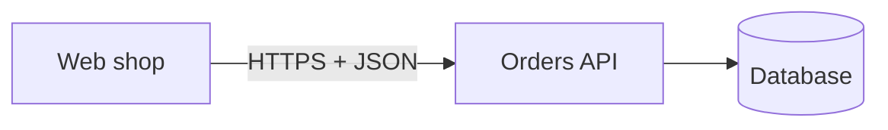

# Architecture

Last changed by: TODO (@username), TODO (YYYY-MM-DD)

## The big picture
TODO: grow this diagram until it shows YOUR platform: every part your squad builds, who uses each one,
the arrows between them (with what travels on each arrow), and where each part runs.
Remove what your squad does not build. GitHub draws the diagram when you view this file.

## Who talks to whom
| From | To | How | What can go wrong | What we do then |
|---|---|---|---|---|
| Web shop | Orders API | HTTPS, JSON, contract/README.md | TODO | TODO |
| TODO | TODO | TODO | TODO | TODO |

## Where each part runs
| Part | On our laptops | Live | Owner |
|---|---|---|---|
| Orders API | TODO | TODO | TODO |
| TODO | TODO | TODO | TODO |

## Decisions
TODO: at least 3 decisions, each with its reason, as a bullet list.
For example: whose pathway project you start from, and why; which host; what you leave out.
