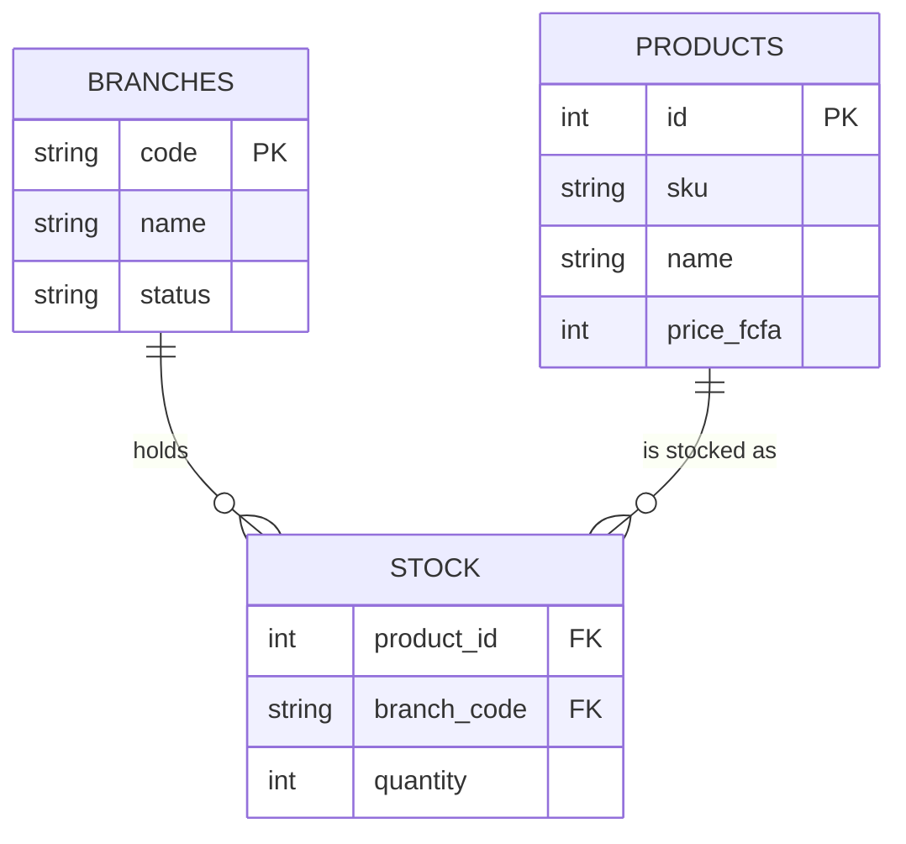

# Database schema

Last changed by: TODO (@username), TODO (YYYY-MM-DD)

## Tables
TODO: add ORDERS, ORDER_ITEMS and USERS, with their keys and the lines between tables.
Keep the names your API really uses. GitHub draws the diagram when you view this file.

## Questions to answer
1. Where is the Idempotency-Key stored, and what stops the same key being saved twice? TODO
2. Why does an order item keep its own unit price instead of reading the product's price? TODO
3. Which columns need a unique rule or an index, and why? TODO
4. What happens to stock rows when an order is created, and when it is cancelled? TODO
